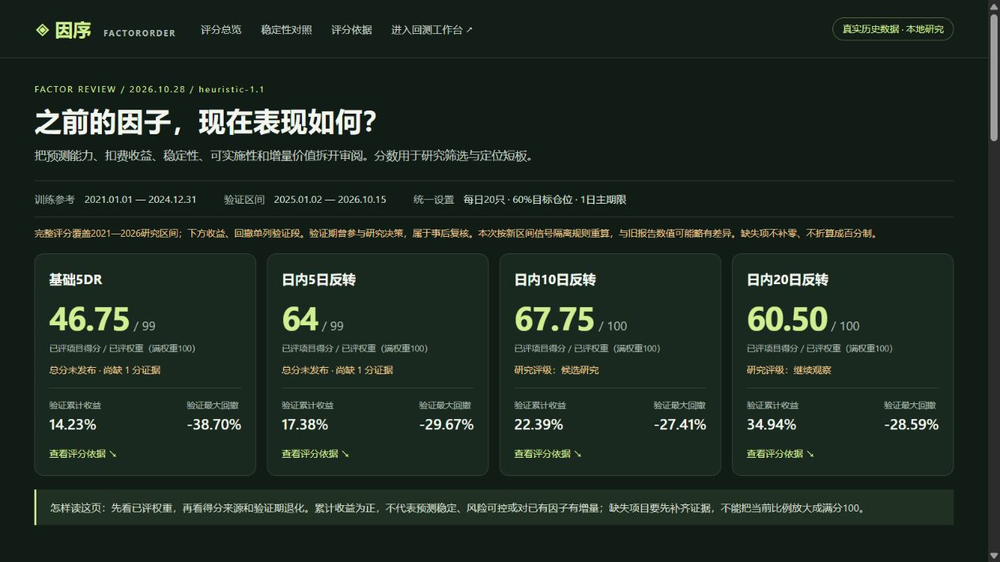
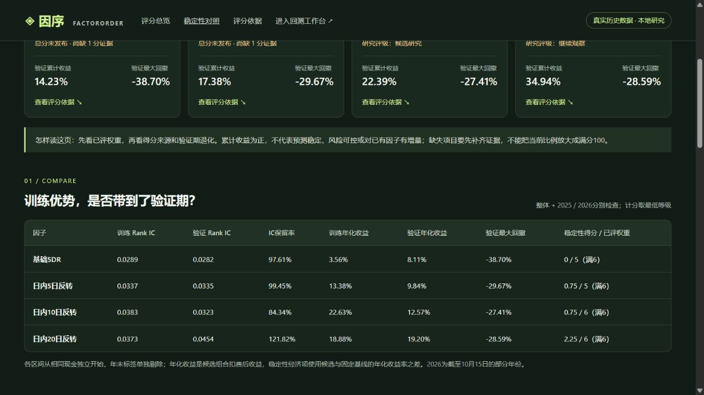

# 历史因子评分展示

这是四个已保存因子在 **v0.6.1 / 评价协议1.1 / heuristic-1.1** 下的真实行情重算结果，整理日期为2026-10-28。评分用于研究筛选、定位短板和审阅证据，不代表盈利概率或实盘准入结论。

[交互式离线报告](report.html) · [评分规则](../../docs/factor_evaluation.md) · [导出来源与原始文件哈希](provenance.json) · [返回历史研究报告](../README.md)

GitHub 文件页可直接阅读本页及截图；下载仓库后，用浏览器打开 `report.html` 即可切换因子、查看分项和逐年稳定性。报告内嵌展示数据，不需要 Python 服务、登录或联网；CSV/JSON 下载链接指向同目录下的公开文件。

## 评分总览

| 因子 | 已评项目得分 | 已评权重（满100） | 总分状态 | 验证累计收益 | 验证最大回撤 |
| --- | ---: | ---: | --- | ---: | ---: |
| [基础5DR](results/baseline/evaluation.json) | 46.75 | 99 | 未发布 | 14.23% | -38.70% |
| [日内5日反转](results/5/evaluation.json) | 64.00 | 99 | 未发布 | 17.38% | -29.67% |
| [日内10日反转](results/10/evaluation.json) | 67.75 | 100 | 候选研究 | 22.39% | -27.41% |
| [日内20日反转](results/20/evaluation.json) | 60.50 | 100 | 继续观察 | 34.94% | -28.59% |

**46.75 / 99 表示得分／已评权重，不能换算为百分制总分。** 基础5DR和日内5日反转的训练 Top-N 同池超额为负，无法定义“正向优势保留率”，因此相应1分未评价；不是遗漏运行。缺失项不补零、不放大其他权重。



## 评分有什么作用

- 区分收益与综合质量：日内20日反转的验证累计收益最高，但综合得分低于10日版本。预测、风险、成本、稳定性和相对已有因子的增量都影响分数。
- 识别整体均值掩盖的衰减：日内5日反转的整体验证 IC 保留率约99.45%，2026年截至10月15日仅约33.36%；IC稳定性采用整体及逐年的最低等级。
- 揭示证据边界：前两个因子未发布总分，原因为保留率参考条件不成立。未评价与表现差得到0分是不同状态。



## 区间与可比口径

完整评分覆盖2021-01-01至2026-10-15。训练参考为2021-01-01至2024-12-31，实际969个交易日；验证为2025-01-02至2026-10-15，实际430个交易日。2026是截至10月15日的部分年份。上表的收益和回撤仅取独立验证段，不能与完整区间的经济评分混为一谈。

四个因子沿用保存的表达式和交易参数：每日20只、目标仓位60%、相同过滤及费用规则。主评价期限1日，辅助期限5/10/20日，启用费用、延迟、资金和平滑四类压力测试。交易基线为20日成交额排名，固定同伴为基础5DR；基础5DR与自身比较的重复度及加入自身的增量计分自然为0。增量分数依赖所选同伴，不能解释为因子的绝对独立价值。

各训练、验证及年度区间从等额现金独立开始；禁止区间前信号进入该段交易，并独立剔除跨越右边界的标签。该口径与旧报告略有差异，所以本次收益数值可能不同。本目录是新增的研究快照，旧报告和账本没有被改写；各年度结果也不能直接拼接为验证整体。

验证期已经被反复查看，属于事后研究复核，不是独立盲测。评分阈值未经独立数据校准，分项存在相关性，尚未校正多重试验。历史ST及官方交易规则缺失、日线撮合信息时点、数据单位等原有限制仍适用，详见[研究完整性说明](../../docs/research_integrity.md)。

## 文件与复跑

`results/baseline/`、`results/5/`、`results/10/`、`results/20/` 各保存：

- `strategy.json`：完整表达式、交易设置和评价协议，可交给现有CLI复跑。
- `evaluation.json`：原始评分、依据、协议摘要和适用限制。
- `evaluation_daily.csv`、`evaluation_quantiles.csv`、`evaluation_yearly.csv`：逐日、分层及年度诊断。
- `evaluation_scenarios.csv`：交易基线、同伴及压力场景。
- `evaluation_stability.csv`、`evaluation_period_returns.csv`：训练验证对照、各区间独立净值与收益。

评价JSON与CSV保持原始字节。`provenance.json` 保存原始文件哈希、代码哈希和运行环境，未分发带本机路径的服务manifest、任务数据库、日志、凭据或原始行情。截图来自相同数据的本地展示页；公开HTML移除了本机服务链接及任务ID。

在仓库根目录核验（无需原始行情或第三方依赖）：

```bash
python scripts/verify_examples.py
python scripts/build_evaluation_report.py --check
```

已有相同合法行情与项目依赖时，例如复跑10日因子：

```bash
python run.py run --data feathers.zip --strategy example_factors/evaluation/results/10/strategy.json --output outputs/evaluation_10d_rerun
```

原始行情SHA-256为 `5766950f2a105244867b842709cf4bad890e4e11df0eebeeaa4fec42dc05803d`，不随仓库分发。不同数据、依赖或代码可能得到不同结果。`assets/` 是离线报告模板，`scripts/build_evaluation_report.py` 从公开JSON生成 `report.html`，不重新计算评分。
