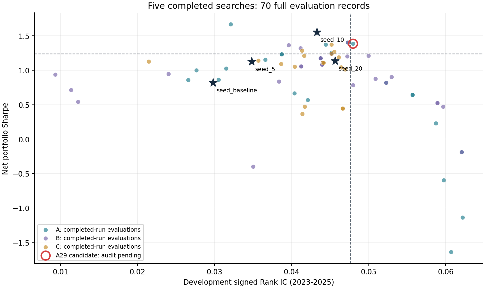

# 因子演化模块：五次完整搜索的阶段验证

在FactorOrder已有回测与因子评分能力之上，验证“提出候选—初筛—完整评价—保留研究对象—继续迭代”的研究流程。

**阶段成果：5次完整搜索、30代、450个候选评价、70个完整评价包。程序判定晋升1个候选，但该组合后代仍缺双成分验证，不能称充分验证的新策略。** 原计划九次搜索；C29完成23个初筛后内存不足停止，另三次未开始。2026复核与前瞻跟踪均未完成。

- [完整中文实验报告](REPORT.md)：方法、结果、统计区间、工程过程及限制。
- [结果证据](data/evidence.json)：全部473条信号级记录，区分完整与中断运行。
- [来源哈希](data/provenance.json)：原始数据、引擎和本地实验产物摘要。
- [候选回测配置](strategies)：4个原始种子、1个程序晋升候选、1个低回撤研究候选。
- [方法源码快照](method_snapshot/README.md)：供审阅，不是独立搜索安装包。
- [审计规则](rules)：原程序裁决逻辑，保留组合后代检查缺口的原始行为。



## 无需行情与API的复核

在仓库根目录执行：

```bash
python research/evolution_v3/verify_submission.py
```

此命令复核450个完整运行候选、23个中断运行候选、70条完整评价裁决、预算和审计标记，不重新运行回测，不调用模型，不访问2026数据。需重跑候选时查看主报告的复现范围说明。

## 交付边界

这是五次已完成运行的阶段报告，不将原九次计划改写为五次，也不把中断当作完成。网页尚未新增一键演化按钮；交付重点为研究原型、可审计结果、平台可读取的配置及离线复核工具。无原始行情、证券代码、订单持仓、密钥或个人API接入地址。
