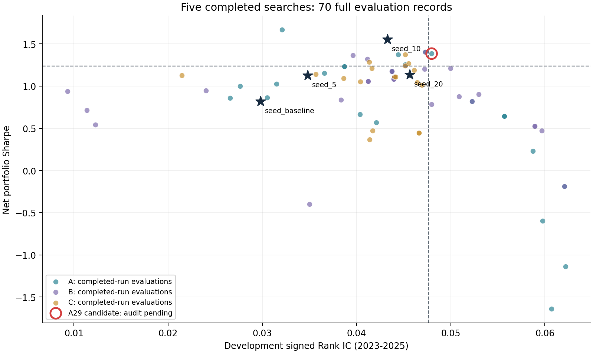

# FactorOrder因子演化模块：五次完整搜索的阶段验证

报告日期：2026年11月6日。证据快照：`data/evidence.json`。本报告面向回测平台的研究能力扩展，全部数值来自已落盘实验，不是模拟示例。

## 摘要与交付范围

在既有因子回测、评分与执行审计基础上，增加“候选生成—信号初筛—完整账户评价—研究池—下一代”的六代搜索流程。本次以 **A17、B17、C17、A29、B29五次完整运行**为阶段交付，累计450个候选评价名额、70个完整评价包，形成1个程序判定晋升的候选。跨运行按AST去重后有369个表达式；450不是450个独立统计假设。初筛无效记录有0个，仍计入已消耗名额。

原设计为A/B/C×随机种子17/29/43共九次搜索，并未预先改为五次。C29完成23个初筛后因内存不足停止，另三次未开始；它们不进入五次主比较，但全部状态在附录披露。五次运行不是按成绩挑选，是已完成的顺序执行前缀。**2026年历史复核与前瞻跟踪均未完成。**

程序晋升候选 A29_g2_s010 相比固定20日锚点提高IC与扣费夏普，但回撤增加。审阅发现其为组合后代，却按local类型绕过双成分比较，因此本报告将其标为**待补充验证候选**，不将程序晋升等同于全面验证成功，也不宣称LLM演化优于普通搜索。

## 1. 平台扩展与研究问题

FactorOrder原有功能回答“一个因子如何表现”；本次研究模块回答“怎样在固定条件下提出、比较和保留下一批因子”。新增研究能力包括：受限表达式配方展开、预登记、三组生成对照、相关性分组、完整回测配额、父子谱系、研究池与诊断池、固定晋升裁决、检查点和费用记录。

本次GitHub交付包含可直接运行的**离线裁决复核入口**、六个可被平台CLI读取的回测配置、473条信号级证据（含中断运行）、70条完整评价摘要、方法源码快照和工程审计。模型搜索原型在独立工作区运行，**尚未集成为网页的一键演化功能**。

研究目标：在固定交易设置下，寻找Rank IC与扣费夏普同时改善的候选；最大回撤作为固定约束与次级排序依据。本版不是强化学习训练，没有更新大模型权重；“演化”指利用候选谱系和测量反馈进行迭代选择。

## 2. 数据、指标与交易设置

2021—2022年为参考期，2023—2025年为开发期；搜索路径在特征与标签计算前截断至2025年末。2026-01-01至2026-10-15仅预留给全部搜索冻结后的统一历史复核，本报告未读取该区间的新复核结果。2026历史此前已有研究接触，即使日后复核也不能称独立盲测。

主标签为下一交易日开盘至再下一交易日开盘的一日收益。Rank IC为每日横截面有符号Spearman相关的均值；Top20超额是信号诊断量，不是扣费账户收益。夏普按252日年化、零无风险利率计算，来自固定交易规则下的净账户收益；回撤以正数损失幅度表示。开发整体使用连续账户，分年度诊断分别重新初始化，不能把年度收益直接拼接为开发账户。

每账户初始资金100万元，日频20只股票、保留排名20、目标仓位60%、单股权重上限4.75%。收盘信号下一交易日执行；佣金0.03%且最低5元，滑点5bp，过户费0.001%，印花税开启；使用前收盘定仓、滞后ADV容量上限1%、最小股价3元、20日平均成交额至少2000万元。原始设置完整保存在JSON。

平台模拟T+1、整手、涨跌停等执行限制，但数据未补齐官方逐日规则与历史ST信息，配置仍为`require_verified_rules=false`、`unknown_st=allow`。因此不能声称已消除全部交易制度偏差或可直接实盘。

原始数据以SHA-256固定：`5766950f2a105244867b842709cf4bad890e4e11df0eebeeaa4fec42dc05803d`。本提交不包含原始行情、证券代码与账户逐笔明细。

## 3. 原始种子与三组方法

四个初始种子为5日收盘反转，以及5/10/20日日内收益反转：

```text
seed_baseline = -rank(ts_return(close, 5))
seed_5       = -rank(ts_sum(log(close / open), 5))
seed_10      = -rank(ts_sum(log(close / open), 10))
seed_20      = -rank(ts_sum(log(close / open), 20))
```

| 原始种子 | 开发Rank IC | 扣费夏普 | 最大回撤 | Top20诊断超额 |
|---|---:|---:|---:|---:|
| seed_baseline | 0.02981 | 0.819 | 32.83% | -0.000482 |
| seed_5 | 0.03480 | 1.126 | 26.60% | 0.000072 |
| seed_10 | 0.04327 | 1.553 | 23.79% | 0.000784 |
| seed_20 | 0.04565 | 1.136 | 29.67% | 0.000645 |

它们来自相关的反转家族，不是四种独立机制。seed_20为固定锚点；seed_10作为更强夏普对照始终保留。

| 组别 | 生成方式 | 动态绩效反馈 |
|---|---|---|
| A | 冻结模板、随机局部修改与参数展开 | 不用于生成和父代选择 |
| B | LLM配方＋本地有限展开 | 不提供动态绩效 |
| C | LLM读取自身前代结果、研究池和失败信息 | 提供 |

B/C使用同一模型标识 `gpt-6.1-sol`、温度0.7、最多4096输出token。随机种子控制本地抽样；没有证据保证模型服务逐字确定性，记录结果可审计不等于重复API调用得到相同文本。

每次六代；每代最多24个表达式、3个完整评价包、36条提案。24个名额分为12个局部修改、8个结构探索、4个两成分等权排名组合。窗口网格固定为2/3/5/7/10/15/20/30/40/60/90/120；候选在任何子候选测量前登记。重复、无效与空槽不会事后补满。每运行最多144次测量、18个完整评价包、12次模型请求、120000 token、6小时活动时间。

先检查因果性、覆盖与逐年正IC，再按每日平均绝对Spearman相关>0.98分组。每代按IC下界、Top20下界和互补性分配三个完整评价名额，每组最多一个。完整评价含开发/参考/逐年账户与成本翻倍、延迟一日、资金翻倍、两日平滑压力场景；一个完整评价包不是一次底层模拟。

## 4. 晋升规则与报告口径

相对固定seed_20，IC至少提高0.002、扣费夏普至少提高0.10、回撤不超过锚点加5个百分点；Top20超额为正且不低于锚点，三年IC为正，至少两年IC和夏普同时不低于该年锚点，成本翻倍与延迟场景夏普分别不低于锚点。

回撤没有作为主目标加权扣分，不能靠低回撤补偿IC/夏普不达标。研究入池、程序晋升、组合双成分验证、历史复核是四种不同状态；本文分别标注。不存在“降低回撤权重就自动成功”的结论。

## 5. 五次完整搜索的结果

| 运行 | 完成代数 | 候选评价 | 完整评价包 | 最终研究池 | 程序晋升 | 模型请求 | 已确认token |
|---|---:|---:|---:|---:|---:|---:|---:|
| A17 | 6/6 | 97 | 11 | 0 | 0 | 0 | 0 |
| B17 | 6/6 | 82 | 15 | 2 | 0 | 11 | 14,905 |
| C17 | 6/6 | 83 | 18 | 2 | 0 | 11 | 29,501 |
| A29 | 6/6 | 95 | 12 | 1 | 1 | 0 | 0 |
| B29 | 6/6 | 93 | 14 | 1 | 0 | 12 | 29,817 |
| 合计 | 30代 | 450 | 70 | 6条运行内记录 | 1 | 34 | 74,223 |



图中每个点是一次完整评价记录，重复表达式可在不同运行出现。虚线仅显示IC/夏普两项主门槛，跨线不代表通过其他条件。红色候选为程序晋升、双成分审计待补充。

| 因子ID | Rank IC | 扣费夏普 | 最大回撤 | Top20诊断超额 |
|---|---:|---:|---:|---:|
| seed_20 | 0.04565 | 1.136 | 29.67% | 0.000645 |
| seed_10 | 0.04327 | 1.553 | 23.79% | 0.000784 |
| A29_g2_s010 | 0.04797 | 1.385 | 31.21% | 0.000794 |
| B17_g2_s003 | 0.04996 | 1.212 | 32.10% | 0.000620 |
| B17_g6_s011 | 0.04517 | 1.243 | 28.35% | 0.000544 |
| C17_g1_s101 | 0.04515 | 1.374 | 31.14% | 0.000367 |
| C17_g4_s004 | 0.04554 | 1.266 | 30.71% | 0.000546 |
| B29_g6_s012 | 0.04723 | 1.201 | 6.97% | 0.000038 |

研究池六条记录全部展示在上表，未把单项最优候选当成最终冠军。A17/B17/C17/B29均冻结为seed_20；A29程序冻结为A29_g2_s010。B29低振幅候选回撤仅6.97%，但主指标增幅及Top20不达标，未晋升。

### 5.1 程序晋升候选及谱系审计

```text
A29_g2_s010 = (rank(-rank(ts_return(close, 40)))
              + rank(-rank(ts_sum(log(close / open), 10)))) / 2
```

生成路径：`seed_baseline + seed_10 → A29_g1_s104（5日收盘与10日日内组合） → A29_g2_s010（把5日改为40日）`。主父A29_g1_s104没有完整评价，程序按设计退回固定锚点比较，不应声称已经证明相对该主父改善。

相对20日锚点，IC增加0.002324、夏普增加0.248675，回撤增加1.54个百分点。相对10日原始种子，IC增加约0.004704，但夏普降低约0.168、回撤增加约7.42个百分点。它不是全面超过所有种子的策略。

**实现缺口：** `check_parents`仅对`kind="combo"`检查双成分，而该候选虽`fusion_depth=1`却标为`local`，没有`parent_comparison`。40日收盘反转成分没有已登记的完整评价，不能确认组合不被该成分支配。这影响唯一程序晋升的证据完整性。当前完整评价中共有7条这类组合后代记录，名单见JSON审计字段。原始裁决保留，报告不给出“已完成组合验证”的新结论，也不额外偷跑成分或回选冠军。

### 5.2 年度与统计不确定性

| 年度 | 锚点IC | 候选IC | 锚点夏普 | 候选夏普 |
|---|---:|---:|---:|---:|
| 2023 | 0.04262 | 0.04143 | 0.409 | 0.527 |
| 2024 | 0.03960 | 0.04724 | 1.009 | 1.128 |
| 2025 | 0.05487 | 0.05543 | 2.058 | 2.730 |

2024、2025年IC与夏普同时不低于锚点；2023年IC略低。候选成本翻倍夏普约1.139、延迟一日夏普约1.305，均通过对应锚点门槛。

20交易日配对区块重采样2000次、固定种子20261104：

| 相对20日锚点的差值 | 点估计 | 95%区间 |
|---|---:|---|
| Rank IC差 | 0.002324 | [-0.004661, 0.008495] |
| 扣费夏普差 | 0.248675 | [-0.368172, 0.673867] |
| Top20超额差 | 0.000148 | [-0.000731, 0.000794] |

三个区间均包含零；未做全部搜索的多重选择校正。程序门槛通过不等于统计显著，也不证明增大候选数量导致改善。

## 6. 工程过程与中断披露

1. B17原计时把现代待机计入6小时限额。Windows事件确认低功耗驻留，按可核实DRIPS秒数保守扣除，保留其他待机活动耗时。修复为不计睡眠的活动时钟，并记录前后哈希、检查点备份和预算日志。
2. 恢复入口通过系统互斥锁避免双进程、原子写入减少检查点损坏，复用已登记候选与成功模型响应；异常重启不清零预算。
3. C29首次请求HTTP 503，用量未知。用户明确授权一次重试后得到2541个已确认token，原失败仍占一次请求和16619 token未知预留。首代两次请求名额耗尽，故没有额外格式修复机会。两次请求均留痕，未知预留不是已核实账单。
4. C29在2026-11-06 08:05完成23个信号初筛后，相关性计算申请60.5MiB数组失败。错误链为`select_screen → groups → corr → panel → Research._prepare → universe.rank`。这表示当时内存分配失败，不表示整个实验只需要60.5MiB内存。

| 原计划运行 | 当前状态 | 本报告处理 |
|---|---|---|
| A17/B17/C17/A29/B29 | 六代完成并冻结 | 五次主结果 |
| C29 | 第1代23个初筛，0个完整评价，MemoryError | 单独披露，不并入主比较 |
| A43/B43/C43 | 未开始 | 不填零收益，不计完成 |
| 2026历史复核 | 未启动 | 不报告结果 |
| 新数据前瞻跟踪 | 未完成 | 不宣称样本外有效 |

五次主结果之外还有C29的2541个已确认token；全部尝试合计76764个已确认token，加16619未知预留。模型运行使用的实际候选数、费用与失败次数不同，不能直接据此认定某组效率优越。

## 7. 能支持的结论与后续工作

已证明平台研究原型能完成从四个种子到多代候选、分层评价、谱系记录和固定裁决的流程；在五次已完成搜索中，观察到单项或部分指标改善以及一个程序晋升的组合变体。

尚不能证明：C优于A/B、LLM优于普通搜索、扩大搜索预算本身有效、晋升因子全面超过种子、或者实盘可获利。样本运行数量少且不均衡，候选高度相关，模型输出不确定，年度/压力/统计证据仍来自开发期；唯一晋升另有组合后代检查缺口。

后续顺序：先在等价性测试下降低矩阵计算的内存峰值；以修订协议补齐所有组合后代的成分检查（保持旧结果不变、明确预算及数据边界）；恢复剩余搜索；全体冻结后统一历史复核，最后开展至少120个有效IC日期的前瞻跟踪。需要改变选择规则时另立版本，不能静默混入原九次对照。

## 8. 复核与复现

在仓库根目录运行 `python research/evolution_v3/verify_submission.py`，无需行情或API，核对文件摘要、计数、预算、五次冻结范围、70条程序晋升裁决和组合审计标记。验证的是**已提交聚合证据及裁决的一致性**，不能从聚合结果重新计算行情IC或账户收益。

有原始数据及使用权限时，可用现有CLI加载`strategies/*.json`重跑某个候选的账户与基础评价。例如：

```bash
python run.py run --data feathers.zip --strategy research/evolution_v3/strategies/A29_g2_s010.json
```

必须确认数据哈希、引擎版本与配置一致；完整压力包、配对重采样和整个演化搜索仍依赖私有研究工作区的基线产物与调用账本，不声称此提交可以在缺少数据时一键重跑全部搜索。方法快照不是独立执行入口，保存的是提交时的工程修订版本；历史冻结脚本摘要单列，不声称五次运行全部采用当前恢复代码。复核命令已接入仓库CI。
